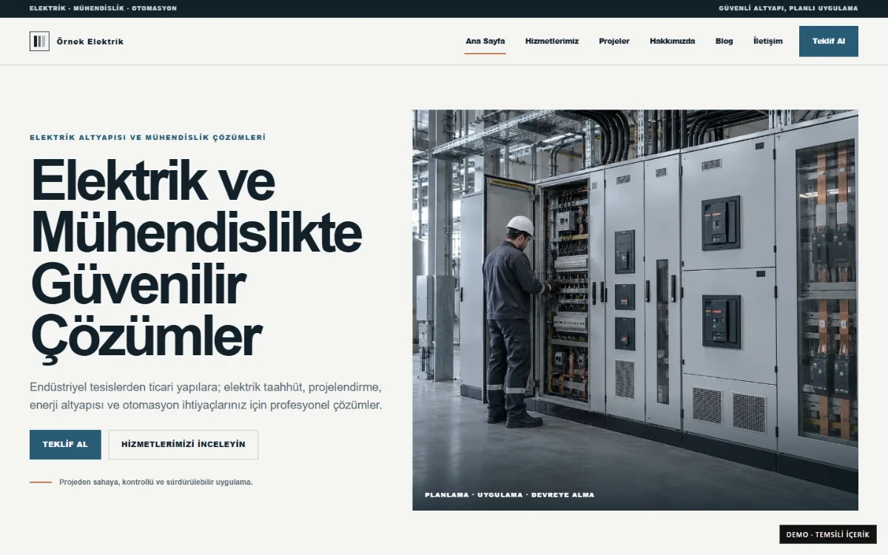
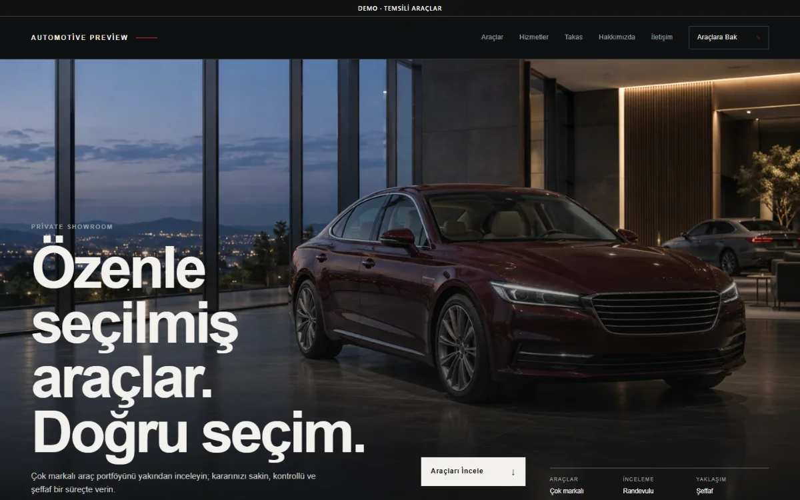
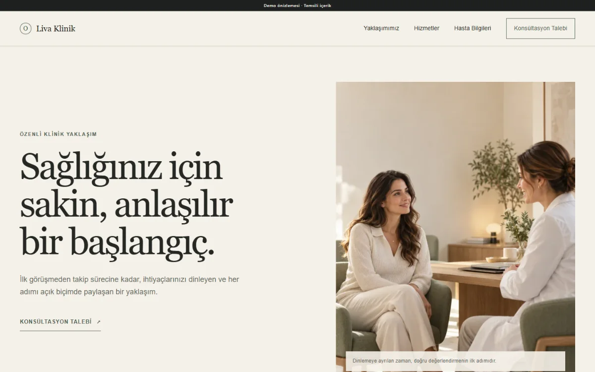
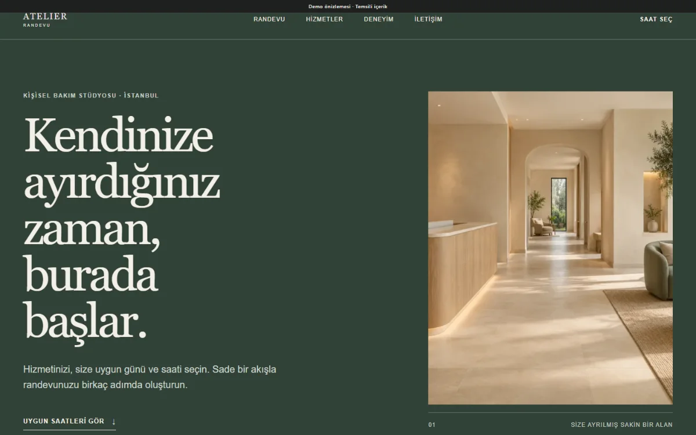
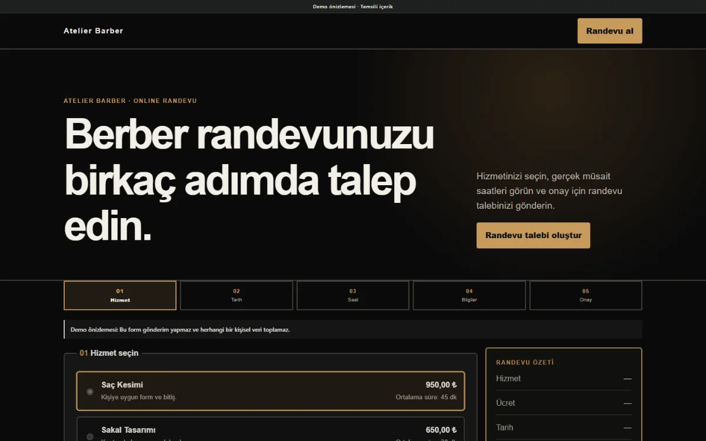
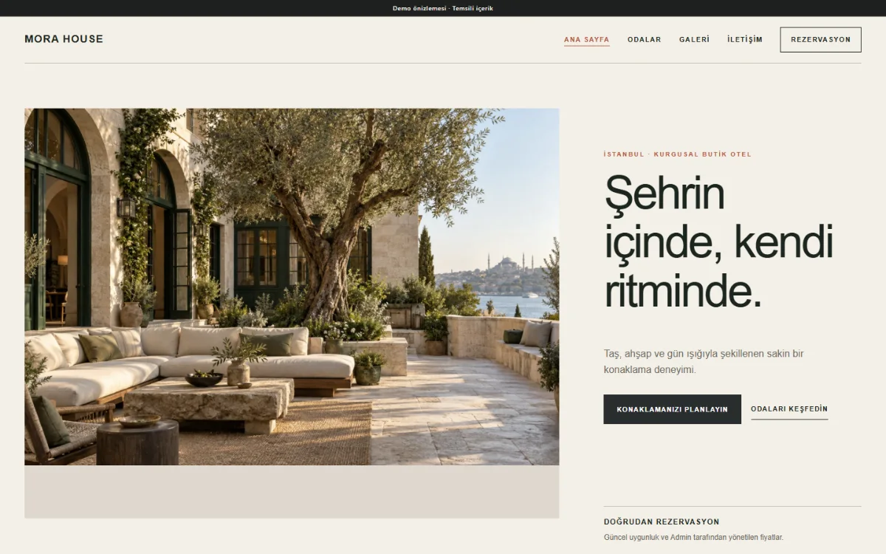
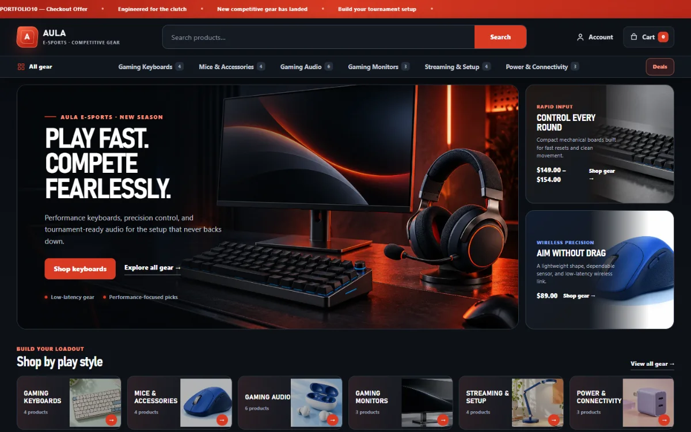

# UGURDEV

### Web development portfolio — PHP, WordPress, WooCommerce, and responsive interfaces

I am a web developer with approximately one year of practical development experience, focused on building clear, responsive websites and dependable commerce experiences. My work combines frontend craft with server-side PHP, structured content, practical security boundaries, testing, and careful debugging.

This portfolio presents seven verified projects. Six are public static demonstrations of PHP products built on a private reusable platform. AULA Esports is a fictional portfolio project built locally with WordPress and WooCommerce; it is not a client commission or an official brand partnership.

[View the projects](#selected-projects) · [Technical focus](#technical-focus) · [GitHub profile](https://github.com/UgurCC0)

## Technical focus

| Area | Practical experience shown here |
| --- | --- |
| Backend | PHP 8.2+, MySQL/MariaDB, PDO-based data access, server-rendered templates |
| WordPress | Custom themes, WordPress administration, WooCommerce catalog and checkout flows |
| Frontend | Semantic HTML, modern CSS, vanilla JavaScript, responsive layouts, accessible controls |
| Commerce | Products, variations, filters, cart, coupons, offline checkout, stock-aware flows |
| Content and SEO | Admin dashboards, controlled media, metadata, canonical URLs, sitemap and robots behavior |
| Quality | Git, browser automation, responsive visual QA, integration testing, debugging and regression checks |

## Selected projects

### 01 — Industrial Electric

A multi-page corporate website for electrical engineering and industrial infrastructure companies. The project pairs a distinctive industrial visual system with shared content, media, blog, and SEO capabilities.

- **Stack:** PHP 8.2+, MySQL/MariaDB, HTML, CSS, JavaScript, custom Site Core theme
- **Highlights:** responsive corporate pages, controlled CMS content, blog and media workflows, SEO-oriented output
[Live static demo](https://ugurweb-elektrik-demo.cancatak59.workers.dev/) · [Case study](projects/industrial-electric.md)

### 02 — Automotive Gallery

A photo-led automotive showroom with vehicle inventory architecture, bounded filters, per-vehicle details, publication states, and a focused sales presentation.

- **Stack:** PHP 8.2+, MySQL/MariaDB, HTML, CSS, JavaScript, Vehicle Inventory module
- **Highlights:** vehicle catalog, filterable inventory, media galleries, published/draft boundaries, detail-page SEO
[Live static demo](https://ugurweb-automotive-demo.cancatak59.workers.dev/) · [Case study](projects/automotive-gallery.md)

### 03 — Clinic Website

A calm, editorial healthcare presentation built around clear information, restrained claims, responsive imagery, and a professional multi-page structure.

- **Stack:** PHP 8.2+, MySQL/MariaDB, HTML, CSS, JavaScript, custom Site Core theme
- **Highlights:** responsive WebP media, accessible navigation, controlled content, SEO metadata, security-aware admin foundation
[Live static demo](https://ugurweb-clinic-demo.cancatak59.workers.dev/) · [Case study](projects/clinic-website.md)

### 04 — Appointment Website

A premium one-page booking interface connected in the PHP product to a reusable appointments capability with real availability rules and transaction-safe conflict checks.

- **Stack:** PHP 8.2+, MySQL/MariaDB, HTML, CSS, JavaScript, Appointments module
- **Highlights:** service/resource selection, date and slot discovery, server-side validation, admin calendar workflows
[Live static demo](https://ugurweb-appointment-demo.cancatak59.workers.dev/) · [Case study](projects/appointment-website.md)

### 05 — Barber Studio

A focused barber booking product that turns service, date, time, and customer details into a concise mobile-friendly request flow.

- **Stack:** PHP 8.2+, MySQL/MariaDB, HTML, CSS, JavaScript, Appointments module
- **Highlights:** live availability architecture, pending request lifecycle, collision prevention, mobile admin workflows
[Live static demo](https://ugurweb-barber-sales-demo.cancatak59.workers.dev/) · [Case study](projects/barber-studio.md)

### 06 — Hotel Booking

A bespoke boutique-hotel website with room types, availability, seasonal pricing rules, reservation management, and an image-led responsive presentation.

- **Stack:** PHP 8.2+, MySQL/MariaDB, HTML, CSS, JavaScript, Hotel Booking module
- **Highlights:** room inventory, date-based availability, price snapshots, reservation states, idempotent submissions
[Live static demo](https://ugurweb-hotel-demo.cancatak59.workers.dev/) · [Case study](projects/hotel-booking.md)

### 07 — AULA Esports

A fictional portfolio project demonstrating a complete custom WordPress and WooCommerce storefront. It uses native WooCommerce data and flows rather than a static store mockup.

- **Stack:** WordPress 7.1.3, WooCommerce 11.2.1, PHP 8.4, MariaDB 10.11, custom theme, CSS, JavaScript
- **Highlights:** 24 products, 6 categories, 12 variations, real catalog filters, cart, native coupon handling, offline checkout, responsive visual QA
Local development demo only · [Case study](projects/aula-esports.md)

## Demo scope

The six public Cloudflare links are static sales demos. They accurately show the responsive frontend, but they do not expose the private PHP runtime, database, Client Admin, or live form processing. Dynamic capabilities described in the case studies are based on inspected source documentation and relevant test evidence. Forms that need a server are deliberately disabled in the public static demos.

AULA Esports runs only on a loopback development environment and is not publicly deployed. No real payment or delivery is offered.

## Contact

For project discussions or collaboration, use my verified public GitHub profile:

**GitHub:** [github.com/UgurCC0](https://github.com/UgurCC0)

No private repository, customer source package, database, credential, or runtime secret is included in this portfolio.
