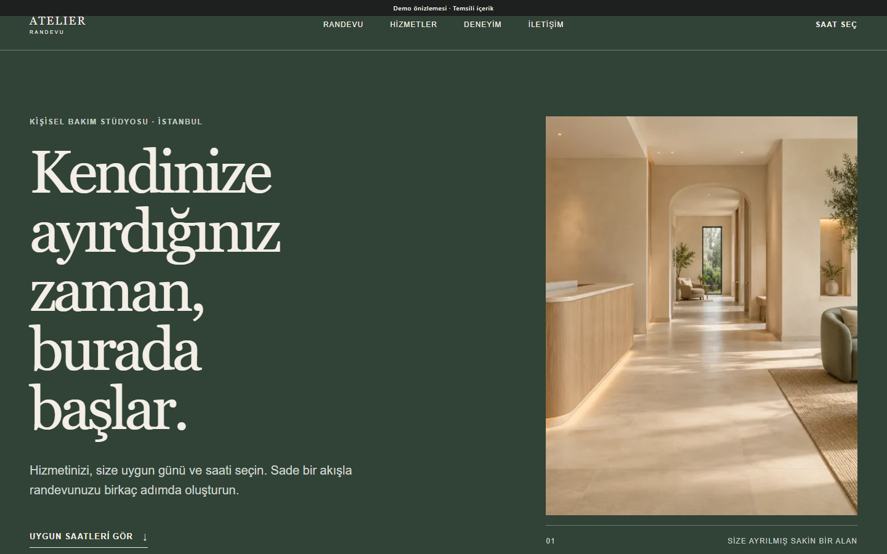
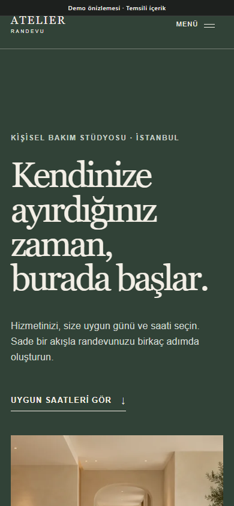

# Appointment Website

## Project overview

Appointment Website is a premium one-page service-booking presentation. The theme owns the customer-facing interface; a separate Appointments capability owns services, resources, schedules, availability, and booking records in dynamic PHP installations.

## Business purpose

The project helps a small service business turn an otherwise complex schedule into a clear service → date → time → details flow while keeping the server authoritative for availability.

## Main functionality

- Service and optional specialist/resource selection.
- Fourteen-day date browsing and available time slots in dynamic installations.
- Weekly hours, closed dates, exceptions, service duration, and buffer rules.
- Transaction-time availability revalidation and collision prevention.
- Safe public status links that expose only request state.
- Client Admin daily/weekly calendar, manual appointments, approval, rejection, cancellation, blocking, and safe rescheduling.
- CSRF, rate limiting, honeypot, and server-side validation.

The public static demo deliberately disables form submission and collects no personal data.

## Technology stack

- PHP 8.2+
- MySQL or MariaDB
- Appointments module
- Server-rendered theme templates
- HTML, CSS, and vanilla JavaScript

## Responsive behavior

The desktop page uses a split hero and structured booking surface. On mobile, fields and choices form one readable column, date controls remain touch-friendly, and key actions keep full-width space.

## Technical challenges

Availability cannot be trusted solely in the browser because another request can claim the same resource and time. The static public demo also needed to stay truthful without pretending to submit to an unavailable backend.

## Implemented solutions

The server revalidates availability inside a transaction and rejects stale or conflicting selections. The frontend displays a clear unavailable/disabled state when the module or schedule is missing, rather than inventing slots.

## Screenshots

| Desktop | Mobile |
| --- | --- |
|  |  |

[Full desktop page](../assets/screenshots/appointment-website/desktop-full.png) · [Full mobile page](../assets/screenshots/appointment-website/mobile-full.png)

## Demo

[Open the live static demo](https://ugurweb-appointment-demo.cancatak59.workers.dev/)

Status verified in Google Chrome on 28 October 2026: HTTP 200, complete page capture, no broken images. Booking submission is intentionally disabled on this static deployment.

[Back to portfolio](../README.md)
