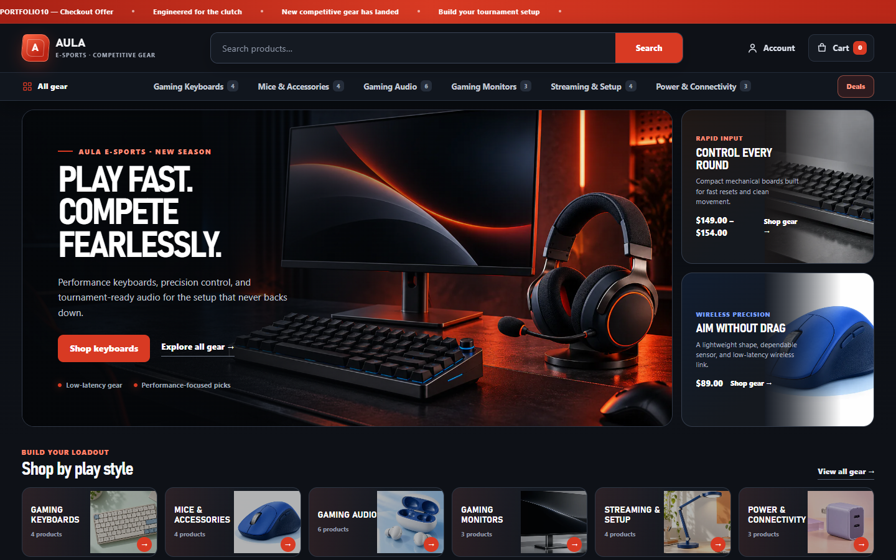
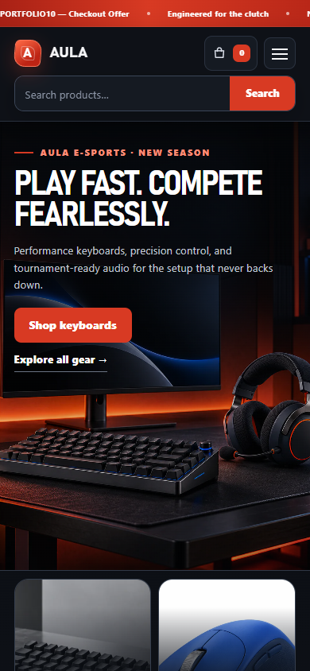
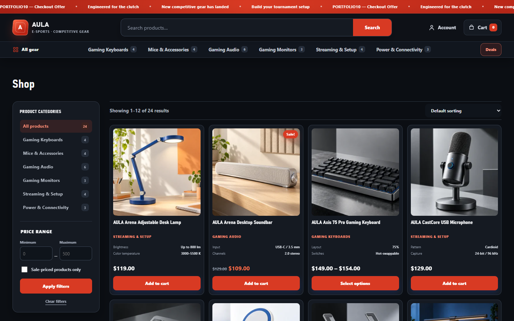
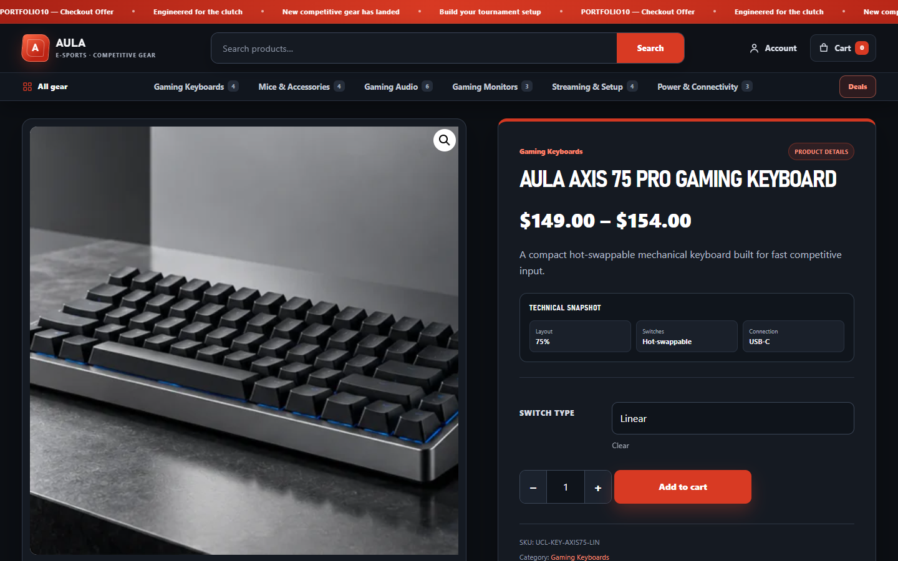
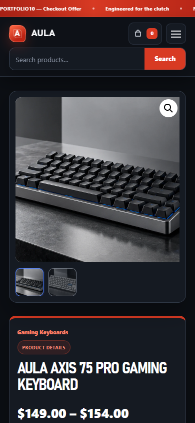
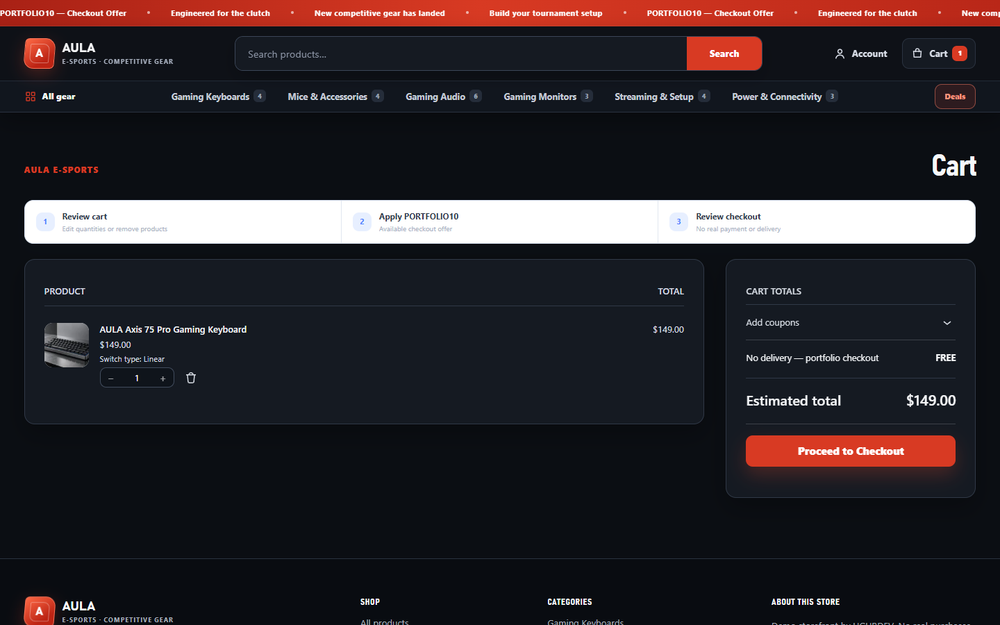
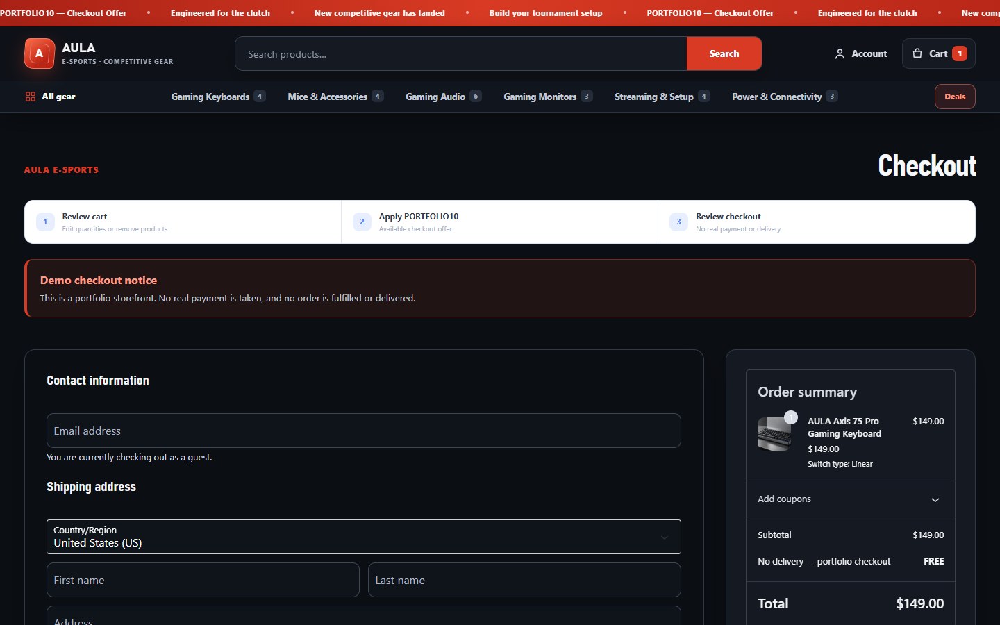

# AULA Esports

> Fictional portfolio project by UGURDEV. This is not a client commission, official AULA website, sponsorship, partnership, or authorized-retailer claim.

## Project overview

AULA Esports is a custom WordPress and WooCommerce storefront built as a local portfolio demonstration. It uses native WooCommerce products, variations, prices, stock, cart, coupons, checkout, and orders rather than a static e-commerce mockup.

## Business purpose

The project demonstrates how an established commerce engine can be given a distinctive, responsive gaming-retail interface without replacing the dependable catalog and order-management workflows underneath.

## Main functionality

- 24 published products across 6 categories, including 12 variations.
- Custom high-energy homepage with category discovery and WooCommerce-driven product rails.
- Shop filters for category, price, sale state, search, and sorting.
- Product galleries, technical attributes, variation selection, native price/stock output, and quantity controls.
- Native Cart updates/removal and the `PORTFOLIO10` coupon.
- Checkout with an offline test gateway, no real payment, and no delivery fulfillment.
- WooCommerce order visibility and inventory reduction were verified in the source project with controlled synthetic test data.
- Responsive layouts validated at desktop, tablet, and mobile widths.

## Technology stack

- WordPress 7.1.3
- WooCommerce 11.2.1
- PHP 8.4.27
- MariaDB 10.11.19
- Custom WordPress theme
- HTML, CSS, vanilla JavaScript, and WooCommerce Blocks
- Playwright/Google Chrome browser testing

## Responsive behavior

The storefront uses dense desktop product discovery while preserving readable two-column mobile catalog cards, compact navigation, touch-friendly variation controls, and usable Cart/Checkout forms. Desktop and mobile hero crops are separate.

## Technical challenges

WooCommerce default and block styles had to coexist with the custom theme without breaking native behavior. Product sliders, lazy-loaded imagery, variation state, mobile Cart actions, and asynchronous Blocks also required real-browser condition-based tests rather than simple CSS or DOM-presence assertions.

## Implemented solutions

The theme keeps WooCommerce as the source of truth and applies scoped presentation layers around native data and actions. Browser regressions verify catalog composition, variation selection, cart updates, coupon calculations, checkout readiness, responsive geometry, console output, and runtime logs. The most recent documented source-project suite reports 21/21 PHP checks passing, with WordPress and WooCommerce checksums verified.

## Screenshots

### Storefront

| Desktop | Mobile |
| --- | --- |
|  |  |

[Full desktop page](../assets/screenshots/aula-esports/desktop-full.png) · [Full mobile page](../assets/screenshots/aula-esports/mobile-full.png)

### Shop and variable product

| Variable product desktop | Variable product mobile |
| --- | --- |
|  |  |

### Cart and Checkout

| Cart | Checkout |
| --- | --- |
|  |  |

[Mobile Cart](../assets/screenshots/aula-esports/cart-mobile.png) · [Mobile Checkout](../assets/screenshots/aula-esports/checkout-mobile.png)

The portfolio capture used an anonymous browser cart only. Checkout was not submitted, no new order was created, and stock was not changed.

## Demo

The working site is currently local-only at `127.0.0.1:8088` and is intentionally not published. The homepage, Shop, product, Cart, and Checkout returned HTTP 200 during the 28 October 2026 Chrome capture session.

The source project reports Lighthouse 13.5.0 scores of 92 desktop and 68 mobile performance, with Accessibility and Best Practices at 100. These results were measured on the loopback PHP development server, not a production web stack; mobile LCP was 5.8 seconds and remains the primary documented performance opportunity.

[Back to portfolio](../README.md)
