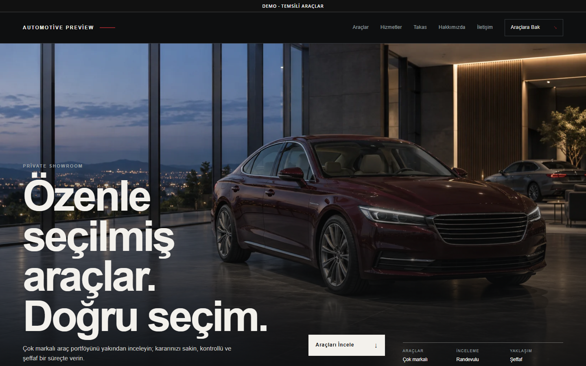
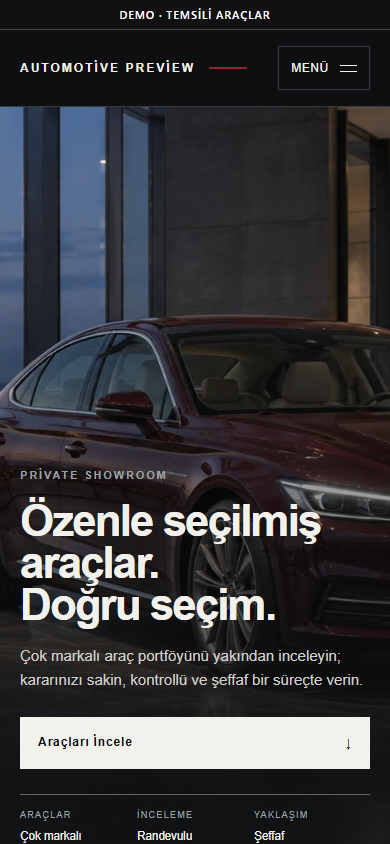

# Automotive Gallery

## Project overview

Automotive Gallery is a photo-led private-showroom website for multi-brand dealers and boutique vehicle sellers. The visual theme works with a dedicated Vehicle Inventory capability in the private PHP product.

## Business purpose

The project presents vehicles with enough structure for customers to compare stock while giving the dealership clear publication control over draft, published, sold, and unpublished records.

## Main functionality

- Home, inventory, vehicle detail, trade-in, About, Services, and Contact pages.
- Admin vehicle create/edit/publish/sold/delete workflows in the PHP product.
- Multiple Media Library images per vehicle, cover selection, and image ordering.
- Vehicle attributes including make, model, year, mileage, price, fuel, transmission, body, technical details, panel condition, and equipment.
- Bounded filters for make, year, price, mileage, fuel, and transmission with pagination.
- Draft/unpublished exclusion, detail-page SEO, and safe redirects after slug changes.

The public deployment is a static showroom export with representative vehicles. Its small client-side filter only affects exported demo cards; it is not the PHP/MySQL inventory system.

## Technology stack

- PHP 8.2+
- MySQL or MariaDB
- Vehicle Inventory module
- Server-rendered templates
- HTML, CSS, and vanilla JavaScript
- Media Library integration and responsive WebP imagery

## Responsive behavior

The wide cinematic hero, two-column vehicle presentation, and editorial trust sections collapse into a single mobile journey without losing pricing, actions, or image emphasis.

## Technical challenges

Inventory data needed strong public/private boundaries and useful filters without exposing drafts. The theme also needed to remain usable as a static sales demo when the dynamic module was absent.

## Implemented solutions

Public queries are bounded and publication-aware. Vehicle detail routes require both the Automotive theme and active module. Eight theme-local records provide only a clearly fictional preview fallback, while dynamic installations use persistent records and Media Library relations.

## Screenshots

| Desktop | Mobile |
| --- | --- |
|  |  |

[Full desktop page](../assets/screenshots/automotive-gallery/desktop-full.png) · [Full mobile page](../assets/screenshots/automotive-gallery/mobile-full.png)

## Demo

[Open the live static demo](https://ugurweb-automotive-demo.cancatak59.workers.dev/)

Status verified in Google Chrome on 28 October 2026: HTTP 200, complete page capture, no broken images. Vehicles, specifications, and prices are fictional demo content.

[Back to portfolio](../README.md)
