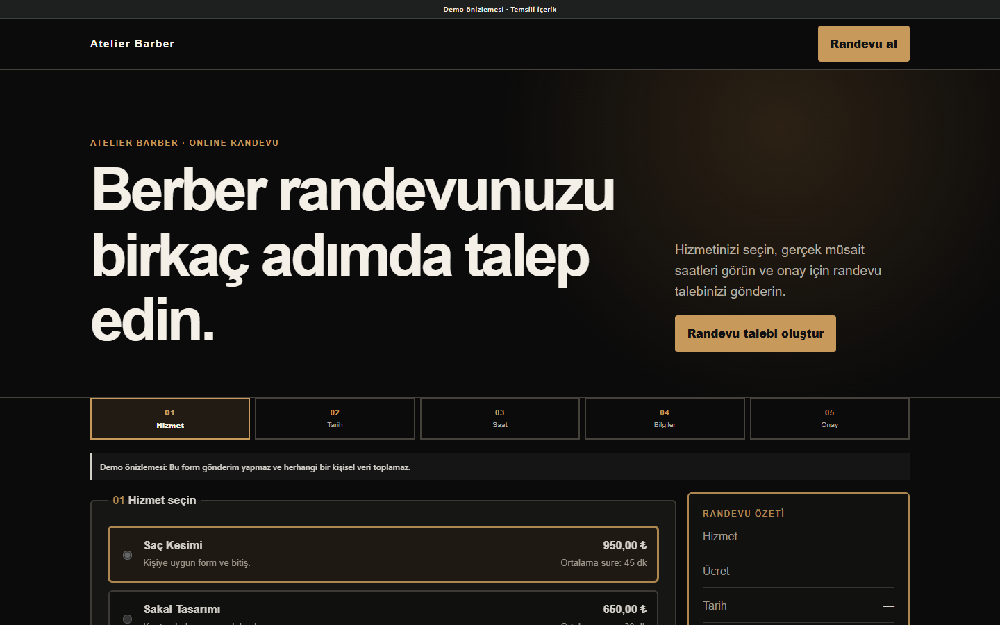
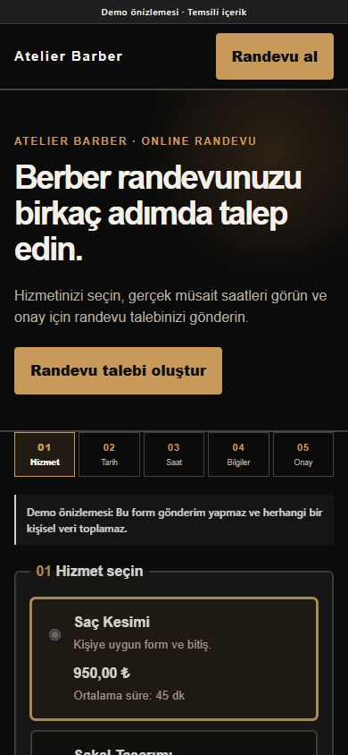

# Barber Studio

## Project overview

Barber Studio is a single-page booking product for a solo barber. It concentrates the experience on service, date, available time, customer details, request summary, and accurate submission feedback.

## Business purpose

The interface gives a small appointment-led business a direct booking journey while providing staff with structured schedule and request management in the dynamic PHP product.

## Main functionality

- Service, date, and real available-time selection in dynamic installations.
- Price, duration, and buffer management.
- Pending requests that reserve the selected slot until approval, rejection, or cancellation.
- Transaction locking and double-booking prevention.
- Client Admin day/week calendars, quick manual appointments, approval, rejection, cancellation, and rescheduling.
- Working hours, closed dates, breaks, and personal time blocks.
- Optional Web Push architecture when HTTPS, VAPID, cron, and a supported device are configured.

Payments, customer accounts, SMS/email delivery, external calendars, and multi-location behavior are not claimed.

## Technology stack

- PHP 8.2+
- MySQL or MariaDB
- Appointments module
- HTML, custom CSS, and vanilla JavaScript
- Optional PWA/Web Push integration boundary

## Responsive behavior

The dark desktop booking grid becomes a compact mobile sequence with touch-sized service cards and a persistent visual hierarchy. The public demo clearly labels the disabled submission state.

## Technical challenges

The booking flow had to represent real schedule rules while preventing concurrent double bookings. Operational status and notification features also needed strict privacy boundaries.

## Implemented solutions

Server-side transactions remain authoritative. Public status tokens reveal only request state, not contact data. Optional push payloads are designed without personal information, and the feature is not represented as delivered unless its production prerequisites are configured.

## Screenshots

| Desktop | Mobile |
| --- | --- |
|  |  |

[Full desktop page](../assets/screenshots/barber-studio/desktop-full.png) · [Full mobile page](../assets/screenshots/barber-studio/mobile-full.png)

## Demo

[Open the live static demo](https://ugurweb-barber-sales-demo.cancatak59.workers.dev/)

Status verified in Google Chrome on 28 October 2026: HTTP 200, complete page capture, no broken images. The static form does not submit or collect personal data.

[Back to portfolio](../README.md)
