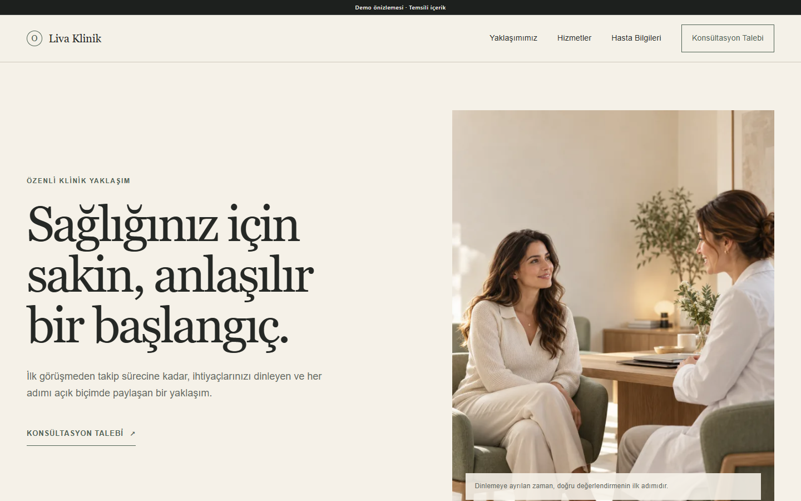
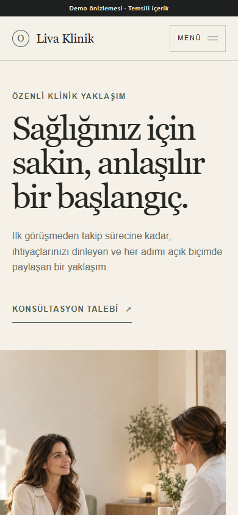

# Clinic Website

## Project overview

Clinic Website is an editorial healthcare presentation with calm typography, warm natural materials, restrained clinical language, and a clear multi-page information structure.

## Business purpose

The design helps a private clinic explain its approach and services without making unsupported medical, credential, outcome, or patient-volume claims.

## Main functionality

- Home, About, Services, and Contact templates.
- Controlled page content, media, and site settings through the shared Client Admin in the PHP product.
- Central SEO titles, descriptions, canonical URLs, and social metadata.
- Responsive images with WebP derivatives and contextual loading behavior.
- Shared authentication, authorization, CSRF, session hardening, and production error-hiding foundations.

No appointments, medical records, patient accounts, telehealth, or payment features are claimed for this project.

## Technology stack

- PHP 8.2+
- MySQL or MariaDB
- Custom Theme Contract implementation
- HTML, CSS, and vanilla JavaScript
- Responsive WebP media

## Responsive behavior

Desktop editorial pairings become a measured single-column mobile flow. The typography scales without clipping, navigation remains compact, and images retain their intended subject framing.

## Technical challenges

Healthcare presentation demands careful copy boundaries and good visual authority without implying real clinical credentials. Large editorial images also needed to remain efficient and predictable across screen sizes.

## Implemented solutions

The theme uses neutral demonstration copy, explicit demo labeling, reusable responsive image derivatives, and controlled content layers. Technical claims are limited to implemented platform behavior.

## Screenshots

| Desktop | Mobile |
| --- | --- |
|  |  |

[Full desktop page](../assets/screenshots/clinic-website/desktop-full.png) · [Full mobile page](../assets/screenshots/clinic-website/mobile-full.png)

## Demo

[Open the live static demo](https://ugurweb-clinic-demo.cancatak59.workers.dev/)

Status verified in Google Chrome on 28 October 2026: HTTP 200, complete page capture, no broken images. The identity and content are fictional.

[Back to portfolio](../README.md)
