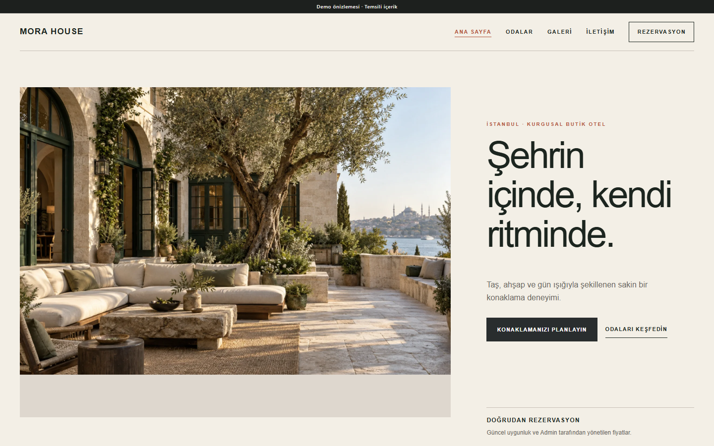
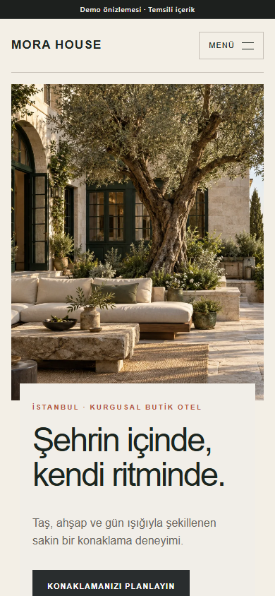

# Hotel Booking

## Project overview

Hotel Booking is a bespoke boutique-hotel presentation with structured room inventory and reservation logic in the private PHP product. The theme covers Home, Rooms, Room detail, Booking, Gallery, and Contact.

## Business purpose

The project gives a small property an image-led direct-booking experience while keeping availability, pricing, room assignment, and reservation state under controlled administration.

## Main functionality

- Room types, physical rooms, capacity, amenities, and Media Library images.
- Base price, weekend price, seasonal ranges, and single-date price exceptions.
- Minimum/maximum stay and forward-booking validation.
- Check-in-inclusive, check-out-exclusive availability calculation.
- Request-to-confirm or instant-booking modes with saved mode snapshot.
- Per-night price breakdown and reservation total snapshot.
- Client Admin reservation search/detail, approval, rejection, cancellation, rescheduling, and room blocking.
- CSRF, honeypot, rate limiting, idempotent submission protection, and collision prevention.

Online payments, OTA/channel-manager integration, guest accounts, notifications, loyalty, and multi-property management are outside this version.

## Technology stack

- PHP 8.2+
- MySQL or MariaDB
- Site-specific Hotel Booking module
- Server-rendered custom theme
- HTML, CSS, vanilla JavaScript, and responsive imagery

## Responsive behavior

Large room imagery and asymmetric editorial sections retain their hierarchy on desktop, while mobile uses a single reading column, touch-friendly calls to action, and carefully cropped photography.

## Technical challenges

Availability and price are date-dependent, and concurrent reservation attempts must not allocate the same physical room. A later pricing change must not silently alter an existing reservation total.

## Implemented solutions

The booking service calculates availability with clear date semantics, stores a nightly price snapshot, uses transaction-safe allocation, and guards repeat submissions with idempotency behavior.

## Screenshots

| Desktop | Mobile |
| --- | --- |
|  |  |

[Full desktop page](../assets/screenshots/hotel-booking/desktop-full.png) · [Full mobile page](../assets/screenshots/hotel-booking/mobile-full.png)

## Demo

[Open the live static demo](https://ugurweb-hotel-demo.cancatak59.workers.dev/)

Status verified in Google Chrome on 28 October 2026: HTTP 200, complete page capture, no broken images. Reservation submission is intentionally disabled on the static deployment.

[Back to portfolio](../README.md)
