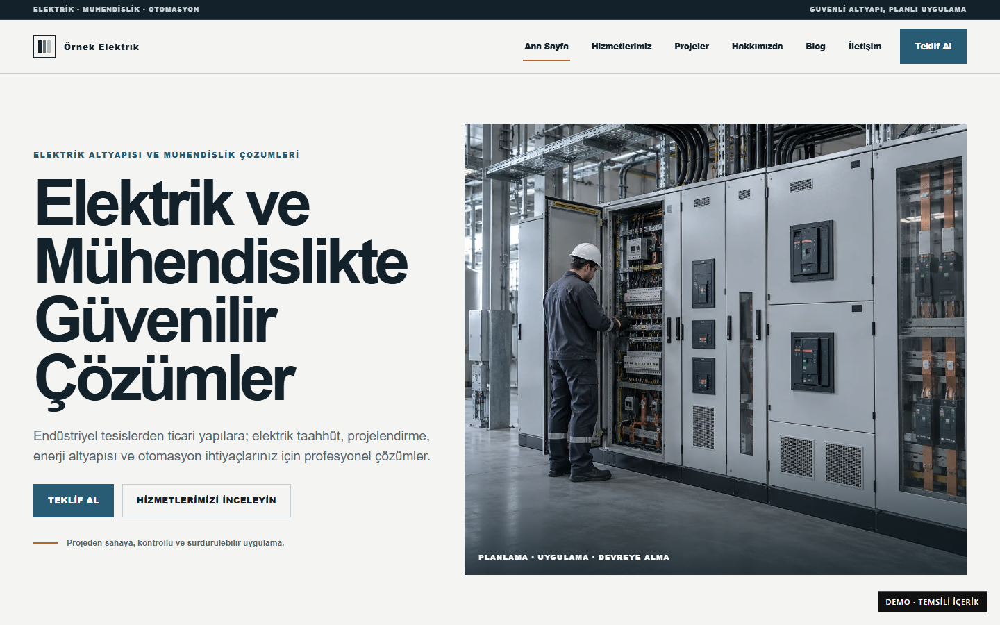
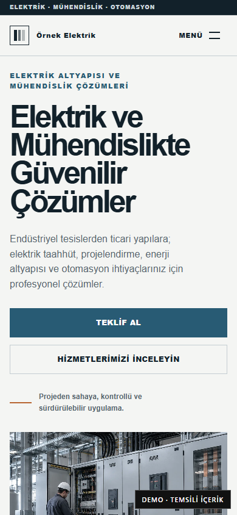

# Industrial Electric

## Project overview

Industrial Electric is a responsive, multi-page corporate presentation for electrical contracting, automation, panel systems, energy infrastructure, and engineering services. It is implemented as a custom theme on a reusable private PHP platform.

## Business purpose

The website gives an industrial service company a credible way to explain capabilities, industries served, representative project types, working process, and technical knowledge without relying on a generic corporate template.

## Main functionality

- Home, About, Services, Projects, Contact, Blog index, and Blog article templates.
- Controlled page content, site settings, media, and blog management through Client Admin in the PHP product.
- Draft/published blog workflow with sanitized rich content.
- Central SEO titles, descriptions, canonical URLs, social metadata, sitemap, and robots behavior.
- Optional WhatsApp quotation handoff when a valid deployment number is configured.

The public demo is static. Client Admin, PHP/MySQL behavior, and form processing are not exposed on that deployment.

## Technology stack

- PHP 8.2+
- MySQL or MariaDB
- PDO-based application services
- Server-rendered PHP templates
- Semantic HTML, custom CSS, and vanilla JavaScript
- Responsive WebP media

## Responsive behavior

The composition changes from a split editorial hero and wide service grids on desktop to a linear mobile hierarchy with full-width actions, readable typography, and an accessible compact navigation.

## Technical challenges

The main challenge was keeping a strong theme-specific industrial identity while reusing shared authentication, CMS, media, SEO, routing, and security systems. Demo content also had to remain clearly representative rather than look like a real client reference.

## Implemented solutions

Theme Contract metadata declares pages, variants, design tokens, and compatibility. Content and branding use controlled settings and deployment overrides instead of raw code editing. Representative imagery and project copy are explicitly labeled as demo material.

## Screenshots

| Desktop | Mobile |
| --- | --- |
|  |  |

[Full desktop page](../assets/screenshots/industrial-electric/desktop-full.png) · [Full mobile page](../assets/screenshots/industrial-electric/mobile-full.png)

## Demo

[Open the live static demo](https://ugurweb-elektrik-demo.cancatak59.workers.dev/)

Status verified in Google Chrome on 28 October 2026: HTTP 200, complete page capture, no broken images. The demo is representative content, not a customer production site.

[Back to portfolio](../README.md)
